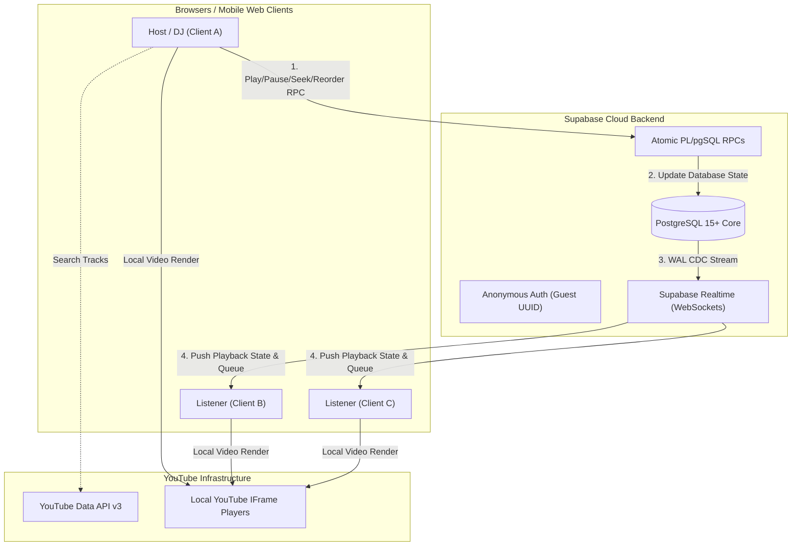

# JAMROOM 🎵

> **Collaborative Music Lounges. All Devices In Sync.**  
> Every connected participant plays the exact same YouTube track at the exact same millisecond. No audio screen-sharing, no registration walls, no credentials required.

---

## 🌟 Overview

**JAMROOM** is a modern, real-time, collaborative music listening and synchronized social lounge platform. Designed for friends, remote teams, music enthusiasts, and online communities, JAMROOM enables multiple users across different devices to listen to music simultaneously in synchronized virtual rooms.

Unlike traditional audio streaming apps or single-device playback models (such as screen sharing or Discord bots), JAMROOM implements an **All-Devices Synchronized Playback Engine**:
- Every connected participant runs an independent, native **YouTube IFrame Player** on their local device.
- All instances are strictly governed by an **Authoritative Backend Playback State** stored in PostgreSQL and broadcast in real time via Supabase WebSockets.
- Visitors join immediately with zero friction through a **Guest-Only Authentication Model** (no email verification, no passwords required, persistent guest sessions with emergency recovery keys).

---

## 🚀 Key Features

### ⏱️ Authoritative Real-Time Synchronization
- **Server Timestamp Master Clock**: Backend PostgreSQL `playback_states` tracks authoritative playback position, playback version, and state updates.
- **Intelligent Drift Correction**: Calibrated specifically for YouTube's player:
  - Imperceptible drift ($\le 0.75\text{s}$) is smoothly left untouched.
  - Significant drift ($> 0.75\text{s}$) triggers throttled compensation with cooldown intervals.
- **Autoplay Policy Interceptor**: Global user gesture listener captures initial interaction events (`click`, `pointerdown`, `keydown`, `touchstart`, `drop`) to seamlessly bypass strict browser audio autoplay restrictions.
- **Custom Player Controls Overlay**: YouTube native iframe clicks are intercepted to direct 100% of playback actions exclusively through JAMROOM's synchronized controls.

### 👤 Zero-Friction Guest Identity
- **Instant Guest Sessions**: Powered by Supabase Anonymous Auth with persistent UUIDs.
- **No Sign-Up Barriers**: Pick a display name and enter or create a lounge in seconds.
- **Emergency Room Recovery Key**: Hosts receive a cryptographically secure 128-bit emergency token (`jam-...`) to reclaim ownership from any browser or incognito window without accounts.
- **Quarantined Secrets**: Room passcodes and recovery hashes are strictly stored in `room_secrets` with zero-client RLS access.

### 🎛️ Dual Authority Modes & Permissions
- **DJ Mode (Curated)**: Only the Room Host and assigned Moderators can play, pause, seek, and manage the queue.
- **Party Mode (Shared Speakers)**: Collaborative mode where any listener in the lounge can control playback.
- **Role Hierarchy**: Comprehensive role-based permissions (`owner`, `moderator`, `listener`) for queue management, track deletion, skip voting, and moderation.

### 📑 Fractional Atomic Queue & Drag-and-Drop Reordering
- **High-Precision Reordering**: Queue ordering is powered by fractional indexing (`NUMERIC(20, 10)`), allowing instantaneous reordering between tracks without massive table updates.
- **Interactive Drag-and-Drop**: Drag cards up or down in the sidebar queue to reorder or drag to the top to immediately autoplay.
- **Democratic Skip Voting**: Server-authoritative skip thresholds calculated against active heartbeats (`last_active_at`), preventing spoofed skip votes.

### 🏷️ Room Categories & Live Discovery
- **13 Standard Curated Genres**: Pop, Rock, Jazz, R&B, Hip Hop, Electronic, Indie, Dangdut, Classical, K-Pop, J-Pop, Lo-fi, and Mixed / Other.
- **Optional & Freeform**: Room category is optional—lounges can be uncategorized or tagged with any vibe.
- **Lounge Directory**: Discover rooms via [Explore Page](file:///c:/Projects/Jamroom/src/pages/ExplorePage.tsx) with horizontal genre filter pills, live search, and privacy tags (`public`, `unlisted`, `password`).

### 📁 Personal Playlists & Playlist Items
- **Saved Collections**: Create playlist folders to organize your favorite tracks.
- **In-Playlist Search & Add**: Search YouTube or paste video URLs directly inside a playlist folder.
- **One-Click Queue Import**: Import an entire playlist into the lounge queue, or copy the active lounge queue into your personal playlist.
- **Direct Search Bookmarking**: Save any song to a playlist straight from the music search modal.

### 💬 Social Interactivity & History
- **Real-Time Live Chat**: Ephemeral, low-latency room chat powered by Supabase Realtime Channels.
- **Floating Reactions**: Animated emoji reactions with floating physics visible to all room participants.
- **Presence Roster**: Live member list showing online status, active counts, and host badges.
- **Playback History**: Automatic recording of any track played in the lounge, with 1-click re-queueing.

---

## 🛠️ Tech Stack

### Frontend
- **Framework**: [React 18](https://react.dev/) + [TypeScript](https://www.typescriptlang.org/)
- **Bundler & Tooling**: [Vite](https://vitejs.dev/)
- **Styling**: [Tailwind CSS](https://tailwindcss.com/)
- **UI Components**: Headless primitives from [@radix-ui](https://www.radix-ui.com/) with [shadcn/ui](https://ui.shadcn.com/) aesthetic
- **State Management**: [Zustand](https://github.com/pmndrs/zustand) (ephemeral UI & audio state)
- **Data Fetching & Cache**: [TanStack Query v5](https://tanstack.com/query)
- **Routing**: [React Router v6](https://reactrouter.com/)
- **Icons**: [Lucide React](https://lucide.dev/)

### Backend & Cloud
- **Database**: [PostgreSQL 15+](https://www.postgresql.org/)
- **BaaS**: [Supabase](https://supabase.com/)
  - **Supabase Auth**: Anonymous guest sessions
  - **Supabase Database**: Stored Procedures (PL/pgSQL RPCs), Row-Level Security (RLS) policies, triggers
  - **Supabase Realtime**: WebSockets (Postgres Changes CDC, Presence, and Broadcast channels)
- **Media Engine**: [YouTube IFrame Player API](https://developers.google.com/youtube/iframe_api_reference) & [YouTube Data API v3](https://developers.google.com/youtube/v3)

---

## 🏗️ Architecture & Sync Strategy



### Architectural Principles:
1. **Decentralized Media, Centralized Truth**:
   The audio never flows through the backend server, eliminating copyright rebroadcast liabilities and heavy server transcoding costs. Instead, clients render YouTube streams locally while strictly synchronizing with the central database clock.
2. **Zero-Client Trust**:
   All permissions, queue fractional indexing, skip votes, and owner recovery claims are executed through PostgreSQL stored procedures protected by Row Level Security (RLS).
3. **Anti-Drift Tolerances**:
   Calculated server playback timestamp:
   $$\text{targetPosition} = \text{position\_seconds} + (\text{now} - \text{server\_updated\_at})$$
   If local player drift exceeds $0.75\text{s}$, a smooth seek syncs the listener to the host.

---

## 📂 Project Structure

```text
Jamroom/
├── docs/                               # Architecture & design specifications
│   ├── CONCURRENCY_STRATEGY.md
│   ├── DATABASE_SCHEMA.md
│   ├── GUEST_AUTHENTICATION.md
│   ├── PLAYBACK_SYNCHRONIZATION.md
│   ├── PROJECT_OVERVIEW.md
│   ├── REALTIME_ARCHITECTURE.md
│   ├── ROOM_PERMISSION_MATRIX.md
│   ├── SECURITY_GUIDELINES.md
│   ├── TECHNICAL_ARCHITECTURE.md
│   └── UI_UX_GUIDELINES.md
├── scripts/                            # Verification & automated test suites
│   ├── verify_categories.mjs
│   └── verify_playlist_items.mjs
├── src/
│   ├── app/                            # App entry point, routing, providers
│   │   ├── App.tsx
│   │   ├── main.tsx
│   │   └── routes.tsx
│   ├── components/                     # Reusable UI components & dialogs
│   │   ├── layout/                     # Navbar, Footer
│   │   ├── room/                       # CreateRoomModal, PasscodeModal, RecoveryModal
│   │   └── ui/                         # shadcn/ui primitives (Button, Dialog, Input, etc.)
│   ├── features/                       # Modular feature domains
│   │   ├── auth/                       # Guest authentication hooks & service
│   │   ├── player/                     # YouTube player, sync hooks, music search modal
│   │   ├── playlist/                   # Playlist modal, items management, room history
│   │   ├── queue/                      # Queue list, reordering, skip voting
│   │   ├── room/                       # Room stage, settings modal, presence, live chat
│   │   └── social/                     # Floating reactions, member roster
│   ├── pages/                          # Application pages
│   │   ├── ExplorePage.tsx             # Lounge discovery directory with category filters
│   │   ├── HomePage.tsx                # Hero landing & active lounges table
│   │   └── RoomPage.tsx                # Authoritative listening stage & studio
│   ├── services/                       # Supabase client configuration
│   ├── stores/                         # Zustand stores (UI, player buffers)
│   └── types/                          # TypeScript database & domain types
├── supabase/                           # Database migrations & schemas
│   ├── migrations/
│   │   ├── 20261117_01_profiles.sql
│   │   ├── 20261117_02_room_system.sql
│   │   ├── 20261117_03_music_queue_playback.sql
│   │   ├── 20261117_03_room_categories.sql
│   │   ├── 20261117_04_playlists_history.sql
│   │   ├── 20261117_05_playlist_items_management.sql
│   │   ├── 20261117_fix_member_kick_and_rls.sql
│   │   ├── 20261117_fix_playback_history.sql
│   │   └── 20261117_fix_reorder_and_queue_rls.sql
│   └── schema_full.sql                 # Complete master PostgreSQL schema
├── index.html
├── package.json
├── tailwind.config.js
├── tsconfig.json
└── vite.config.ts
```

---

## 🚦 Getting Started

### Prerequisites
- **Node.js**: v18.0.0 or higher
- **npm** or **pnpm**
- **Supabase Account**: A free Supabase project (or self-hosted Supabase instance)
- **YouTube Data API v3 Key** *(Optional)*: Required for in-app keyword search. If not provided, direct YouTube video URLs and Video IDs work out-of-the-box.

---

### Installation

1. **Clone the repository**:
   ```bash
   git clone https://github.com/your-username/jamroom.git
   cd jamroom
   ```

2. **Install dependencies**:
   ```bash
   npm install
   ```

3. **Set up environment variables**:
   Create a `.env` file in the root directory (based on `.env.example`):
   ```bash
   cp .env.example .env
   ```

   Fill in your Supabase credentials:
   ```env
   # Supabase Configuration
   VITE_SUPABASE_URL=https://your-project.supabase.co
   VITE_SUPABASE_ANON_KEY=your-anon-public-key

   # YouTube API Configuration (Optional)
   VITE_YOUTUBE_API_KEY=your-youtube-data-api-key
   ```

4. **Initialize Database Schema**:
   In your Supabase project's **SQL Editor**, execute the contents of:
   - [supabase/schema_full.sql](file:///c:/Projects/Jamroom/supabase/schema_full.sql)  
   *(or run the migration files sequentially from `supabase/migrations/`)*

   > **Note on Anonymous Auth**:  
   > Ensure **Anonymous Sign-ins** are enabled in Supabase under:  
   > `Authentication > Providers > Anonymous Sign-ins`.

5. **Start Development Server**:
   ```bash
   npm run dev
   ```
   Open your browser at `http://localhost:5173`.

---

## 🧪 Testing & Verification

JAMROOM includes automated test suites to verify business logic, security policies, and permissions:

```bash
# Verify Room Categories, Optional Assignment & RLS Authorizations
node scripts/verify_categories.mjs

# Verify Playlist Folder & Playlist Items Management
node scripts/verify_playlist_items.mjs

# TypeScript & Production Bundle Health Check
npm run build
```

---

## 🛡️ Security & Privacy Architecture

- **Row Level Security (RLS)**: Every table has explicit RLS policies. Client applications can never bypass backend access control.
- **Quarantined Room Secrets**: Passwords and host recovery hashes reside in `room_secrets` with `FOR ALL USING (false)`—they can only be verified or modified via `SECURITY DEFINER` stored procedures.
- **Fractional Indexing Locking**: Queue modifications and drag-and-drop operations utilize advisory locks (`pg_advisory_xact_lock`) to prevent race conditions during rapid concurrent reordering.
- **Auto Clean-up**: Disconnected or inactive listeners are pruned by heartbeat monitors to keep skip vote thresholds accurate.

---

## 📜 Available Scripts

| Command | Description |
| :--- | :--- |
| `npm run dev` | Starts Vite local development server with Hot Module Replacement |
| `npm run build` | Runs TypeScript compiler checks (`tsc`) and compiles production bundle with Vite |
| `npm run preview` | Previews the compiled production build locally |
| `npm run lint` | Runs ESLint analysis across the TypeScript and JSX files |

---

## 📄 License

This project is open-source and available under the [MIT License](LICENSE).
