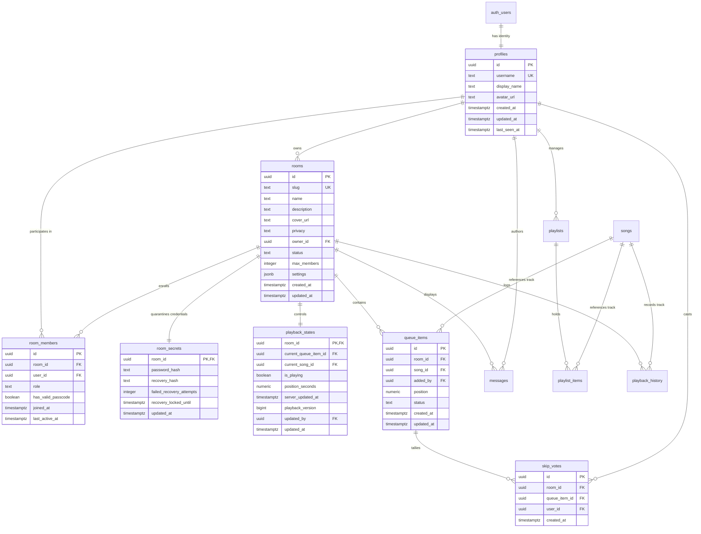

# JAMROOM — Database Schema Specification (Audited & Hardened)

## 1. Relational Architecture Overview

JAMROOM uses PostgreSQL 15+ hosted on Supabase. Following Principal Architecture Review, the database enforces:
- **Zero Exposure of Sensitive Hashes**: Room passcodes and recovery secrets are isolated into a zero-access table (`public.room_secrets`) with strict `RLS: false`, accessible exclusively via `SECURITY DEFINER` stored procedures.
- **Strict Relational Integrity & Non-Recursive RLS**: Clean foreign keys with non-recursive Row-Level Security policies to prevent PostgreSQL policy loops.
- **High-Precision Fractional Indexing (`NUMERIC(20, 10)`)**: Prevents precision exhaustion during intensive queue drag-and-drop operations, accompanied by automatic normalization.
- **Server-Side Active Member Tracking**: `room_members.last_active_at` enables server-authoritative skip vote calculations without relying on client-supplied counts.



---

## 2. Table Definitions (DDL)

```sql
-- Enable necessary extensions
CREATE EXTENSION IF NOT EXISTS "uuid-ossp";
CREATE EXTENSION IF NOT EXISTS "pgcrypto";

-- ============================================================================
-- 1. PROFILES (Public mirror of auth.users for Anonymous & Authenticated Guests)
-- ============================================================================
CREATE TABLE public.profiles (
    id UUID PRIMARY KEY REFERENCES auth.users(id) ON DELETE CASCADE,
    username TEXT UNIQUE,
    display_name TEXT NOT NULL,
    avatar_url TEXT,
    created_at TIMESTAMPTZ NOT NULL DEFAULT clock_timestamp(),
    updated_at TIMESTAMPTZ NOT NULL DEFAULT clock_timestamp(),
    last_seen_at TIMESTAMPTZ NOT NULL DEFAULT clock_timestamp(),
    CONSTRAINT username_format CHECK (username ~* '^[a-zA-Z0-9_-]{3,30}$')
);

-- ============================================================================
-- 2. ROOMS (Public Room Metadata - No Sensitive Hashes)
-- ============================================================================
CREATE TABLE public.rooms (
    id UUID PRIMARY KEY DEFAULT gen_random_uuid(),
    slug TEXT NOT NULL UNIQUE,
    name TEXT NOT NULL CHECK (char_length(trim(name)) >= 2 AND char_length(name) <= 60),
    description TEXT CHECK (char_length(description) <= 280),
    cover_url TEXT,
    privacy TEXT NOT NULL CHECK (privacy IN ('public', 'unlisted', 'password')) DEFAULT 'public',
    owner_id UUID NOT NULL REFERENCES public.profiles(id) ON DELETE RESTRICT,
    status TEXT NOT NULL CHECK (status IN ('active', 'archived')) DEFAULT 'active',
    max_members INTEGER NOT NULL DEFAULT 50 CHECK (max_members BETWEEN 2 AND 200),
    settings JSONB NOT NULL DEFAULT '{
        "shared_speakers": false,
        "add_to_queue_permission": "anyone",
        "reorder_queue_permission": "host_and_mods_only",
        "vote_skip_enabled": true,
        "skip_vote_threshold_percent": 50,
        "max_queue_items_per_user": 5,
        "chat_enabled": true,
        "auto_play_on_queue_add": true
    }'::jsonb,
    created_at TIMESTAMPTZ NOT NULL DEFAULT clock_timestamp(),
    updated_at TIMESTAMPTZ NOT NULL DEFAULT clock_timestamp()
);

-- ============================================================================
-- 3. ROOM SECRETS (Quarantined Credentials - Zero Client RLS Access)
-- ============================================================================
CREATE TABLE public.room_secrets (
    room_id UUID PRIMARY KEY REFERENCES public.rooms(id) ON DELETE CASCADE,
    password_hash TEXT, -- Hashed room passcode
    recovery_hash TEXT, -- Hashed emergency recovery token
    failed_recovery_attempts INTEGER NOT NULL DEFAULT 0,
    recovery_locked_until TIMESTAMPTZ,
    updated_at TIMESTAMPTZ NOT NULL DEFAULT clock_timestamp()
);

-- ============================================================================
-- 4. ROOM MEMBERS (Membership, Roles, Passcode Status & Activity Heartbeats)
-- ============================================================================
CREATE TABLE public.room_members (
    id UUID PRIMARY KEY DEFAULT gen_random_uuid(),
    room_id UUID NOT NULL REFERENCES public.rooms(id) ON DELETE CASCADE,
    user_id UUID NOT NULL REFERENCES public.profiles(id) ON DELETE CASCADE,
    role TEXT NOT NULL CHECK (role IN ('owner', 'moderator', 'member')) DEFAULT 'member',
    has_valid_passcode BOOLEAN NOT NULL DEFAULT false,
    joined_at TIMESTAMPTZ NOT NULL DEFAULT clock_timestamp(),
    last_active_at TIMESTAMPTZ NOT NULL DEFAULT clock_timestamp(),
    CONSTRAINT unique_room_member UNIQUE (room_id, user_id)
);

-- ============================================================================
-- 5. SONGS (Global Normalized Track Catalog)
-- ============================================================================
CREATE TABLE public.songs (
    id UUID PRIMARY KEY DEFAULT gen_random_uuid(),
    youtube_id TEXT NOT NULL UNIQUE,
    title TEXT NOT NULL,
    artist_channel TEXT,
    duration_seconds INTEGER NOT NULL CHECK (duration_seconds > 0),
    thumbnail_url TEXT,
    raw_metadata JSONB DEFAULT '{}'::jsonb,
    created_at TIMESTAMPTZ NOT NULL DEFAULT clock_timestamp()
);

-- ============================================================================
-- 6. QUEUE ITEMS (Room Song Queues - High Precision Fractional Ordering)
-- ============================================================================
CREATE TABLE public.queue_items (
    id UUID PRIMARY KEY DEFAULT gen_random_uuid(),
    room_id UUID NOT NULL REFERENCES public.rooms(id) ON DELETE CASCADE,
    song_id UUID NOT NULL REFERENCES public.songs(id) ON DELETE RESTRICT,
    added_by UUID REFERENCES public.profiles(id) ON DELETE SET NULL,
    position NUMERIC(20, 10) NOT NULL, -- 10 decimal places to eliminate precision collapse
    status TEXT NOT NULL CHECK (status IN ('queued', 'playing', 'played', 'skipped')) DEFAULT 'queued',
    created_at TIMESTAMPTZ NOT NULL DEFAULT clock_timestamp(),
    updated_at TIMESTAMPTZ NOT NULL DEFAULT clock_timestamp()
);

-- ============================================================================
-- 7. PLAYBACK STATES (Authoritative Sync Single Source of Truth)
-- ============================================================================
CREATE TABLE public.playback_states (
    room_id UUID PRIMARY KEY REFERENCES public.rooms(id) ON DELETE CASCADE,
    current_queue_item_id UUID REFERENCES public.queue_items(id) ON DELETE SET NULL,
    current_song_id UUID REFERENCES public.songs(id) ON DELETE SET NULL,
    is_playing BOOLEAN NOT NULL DEFAULT false,
    position_seconds NUMERIC(10, 3) NOT NULL DEFAULT 0.000,
    server_updated_at TIMESTAMPTZ NOT NULL DEFAULT clock_timestamp(),
    playback_version BIGINT NOT NULL DEFAULT 1,
    updated_by UUID REFERENCES public.profiles(id) ON DELETE SET NULL,
    updated_at TIMESTAMPTZ NOT NULL DEFAULT clock_timestamp()
);

-- ============================================================================
-- 8. MESSAGES (Room Live Chat)
-- ============================================================================
CREATE TABLE public.messages (
    id UUID PRIMARY KEY DEFAULT gen_random_uuid(),
    room_id UUID NOT NULL REFERENCES public.rooms(id) ON DELETE CASCADE,
    user_id UUID NOT NULL REFERENCES public.profiles(id) ON DELETE CASCADE,
    content TEXT NOT NULL CHECK (char_length(trim(content)) >= 1 AND char_length(content) <= 1000),
    type TEXT NOT NULL CHECK (type IN ('user', 'system', 'announcement')) DEFAULT 'user',
    created_at TIMESTAMPTZ NOT NULL DEFAULT clock_timestamp()
);

-- ============================================================================
-- 9. SKIP VOTES (Democratic Song Skip Tallies)
-- ============================================================================
CREATE TABLE public.skip_votes (
    id UUID PRIMARY KEY DEFAULT gen_random_uuid(),
    room_id UUID NOT NULL REFERENCES public.rooms(id) ON DELETE CASCADE,
    queue_item_id UUID NOT NULL REFERENCES public.queue_items(id) ON DELETE CASCADE,
    user_id UUID NOT NULL REFERENCES public.profiles(id) ON DELETE CASCADE,
    created_at TIMESTAMPTZ NOT NULL DEFAULT clock_timestamp(),
    CONSTRAINT unique_user_skip_vote UNIQUE (queue_item_id, user_id)
);

-- ============================================================================
-- 10. PLAYLISTS (User Playlists)
-- ============================================================================
CREATE TABLE public.playlists (
    id UUID PRIMARY KEY DEFAULT gen_random_uuid(),
    user_id UUID NOT NULL REFERENCES public.profiles(id) ON DELETE CASCADE,
    name TEXT NOT NULL CHECK (char_length(trim(name)) >= 1 AND char_length(name) <= 100),
    description TEXT,
    is_public BOOLEAN NOT NULL DEFAULT false,
    created_at TIMESTAMPTZ NOT NULL DEFAULT clock_timestamp(),
    updated_at TIMESTAMPTZ NOT NULL DEFAULT clock_timestamp()
);

-- ============================================================================
-- 11. PLAYLIST ITEMS (Songs within a Playlist)
-- ============================================================================
CREATE TABLE public.playlist_items (
    id UUID PRIMARY KEY DEFAULT gen_random_uuid(),
    playlist_id UUID NOT NULL REFERENCES public.playlists(id) ON DELETE CASCADE,
    song_id UUID NOT NULL REFERENCES public.songs(id) ON DELETE CASCADE,
    position INTEGER NOT NULL,
    created_at TIMESTAMPTZ NOT NULL DEFAULT clock_timestamp(),
    CONSTRAINT unique_playlist_position UNIQUE (playlist_id, position)
);

-- ============================================================================
-- 12. PLAYBACK HISTORY (Room Listening Log)
-- ============================================================================
CREATE TABLE public.playback_history (
    id UUID PRIMARY KEY DEFAULT gen_random_uuid(),
    room_id UUID NOT NULL REFERENCES public.rooms(id) ON DELETE CASCADE,
    song_id UUID NOT NULL REFERENCES public.songs(id) ON DELETE CASCADE,
    played_by UUID REFERENCES public.profiles(id) ON DELETE SET NULL,
    played_at TIMESTAMPTZ NOT NULL DEFAULT clock_timestamp(),
    duration_seconds INTEGER NOT NULL
);

-- ============================================================================
-- 13. YOUTUBE SEARCH CACHE (API Quota Conservation)
-- ============================================================================
CREATE TABLE public.youtube_search_cache (
    query_hash TEXT PRIMARY KEY,
    query_text TEXT NOT NULL,
    results JSONB NOT NULL,
    created_at TIMESTAMPTZ NOT NULL DEFAULT clock_timestamp(),
    expires_at TIMESTAMPTZ NOT NULL
);
```

---

## 3. Indexes & Performance Optimization

```sql
-- Fast lookup for room slugs
CREATE INDEX idx_rooms_slug ON public.rooms(slug);
CREATE INDEX idx_rooms_status_privacy ON public.rooms(status, privacy) WHERE status = 'active';

-- Room membership indices & activity tracking
CREATE INDEX idx_room_members_room ON public.room_members(room_id);
CREATE INDEX idx_room_members_user ON public.room_members(user_id);
CREATE INDEX idx_room_members_active ON public.room_members(room_id, last_active_at);

-- Queue ordering and status
CREATE INDEX idx_queue_items_room_status_pos ON public.queue_items(room_id, status, position);
CREATE INDEX idx_queue_items_added_by ON public.queue_items(added_by, room_id);

-- Playback state fast lookup
CREATE INDEX idx_playback_states_room ON public.playback_states(room_id);

-- Messages chronological fetch
CREATE INDEX idx_messages_room_created ON public.messages(room_id, created_at DESC);

-- Skip votes tallying
CREATE INDEX idx_skip_votes_queue_item ON public.skip_votes(queue_item_id);

-- Playback history chronological fetch
CREATE INDEX idx_playback_history_room ON public.playback_history(room_id, played_at DESC);

-- Cache expiration index
CREATE INDEX idx_yt_cache_expires ON public.youtube_search_cache(expires_at);
```

---

## 4. Automatic Triggers & Stored Procedures

### 4.1 Automatic Profile Generation for Anonymous Guests
```sql
CREATE OR REPLACE FUNCTION public.handle_new_auth_user()
RETURNS trigger AS $$
BEGIN
    INSERT INTO public.profiles (id, username, display_name, avatar_url, last_seen_at)
    VALUES (
        NEW.id,
        'guest_' || substr(NEW.id::text, 1, 8),
        COALESCE(NEW.raw_user_meta_data->>'display_name', 'Guest ' || substr(NEW.id::text, 1, 4)),
        COALESCE(NEW.raw_user_meta_data->>'avatar_url', 'https://api.dicebear.com/7.x/bottts/svg?seed=' || NEW.id::text),
        clock_timestamp()
    )
    ON CONFLICT (id) DO NOTHING;
    RETURN NEW;
END;
$$ LANGUAGE plpgsql SECURITY DEFINER;

CREATE OR REPLACE TRIGGER on_auth_user_created
    AFTER INSERT ON auth.users
    FOR EACH ROW EXECUTE FUNCTION public.handle_new_auth_user();
```

### 4.2 Auto-Touch `updated_at` Timestamp
```sql
CREATE OR REPLACE FUNCTION public.touch_updated_at()
RETURNS trigger AS $$
BEGIN
    NEW.updated_at = clock_timestamp();
    RETURN NEW;
END;
$$ LANGUAGE plpgsql;

CREATE TRIGGER touch_rooms_updated_at BEFORE UPDATE ON public.rooms FOR EACH ROW EXECUTE FUNCTION public.touch_updated_at();
CREATE TRIGGER touch_room_secrets_updated_at BEFORE UPDATE ON public.room_secrets FOR EACH ROW EXECUTE FUNCTION public.touch_updated_at();
CREATE TRIGGER touch_profiles_updated_at BEFORE UPDATE ON public.profiles FOR EACH ROW EXECUTE FUNCTION public.touch_updated_at();
CREATE TRIGGER touch_queue_items_updated_at BEFORE UPDATE ON public.queue_items FOR EACH ROW EXECUTE FUNCTION public.touch_updated_at();
CREATE TRIGGER touch_playlists_updated_at BEFORE UPDATE ON public.playlists FOR EACH ROW EXECUTE FUNCTION public.touch_updated_at();
```

---

## 5. Hardened Row-Level Security (RLS) Policies

All public tables have RLS enabled: `ALTER TABLE ... ENABLE ROW LEVEL SECURITY;`

### 5.1 Profiles Table
```sql
ALTER TABLE public.profiles ENABLE ROW LEVEL SECURITY;

CREATE POLICY "Public profiles are readable by anyone"
    ON public.profiles FOR SELECT
    USING (true);

CREATE POLICY "Users can only update their own profile"
    ON public.profiles FOR UPDATE
    USING (auth.uid() = id)
    WITH CHECK (auth.uid() = id);
```

### 5.2 Rooms Table
```sql
ALTER TABLE public.rooms ENABLE ROW LEVEL SECURITY;

-- Anyone can browse active rooms (public/unlisted/password metadata)
CREATE POLICY "Rooms viewable based on status"
    ON public.rooms FOR SELECT
    USING (status = 'active');

CREATE POLICY "Any authenticated guest can create a room"
    ON public.rooms FOR INSERT
    WITH CHECK (auth.uid() = owner_id);

CREATE POLICY "Only room owner can update room"
    ON public.rooms FOR UPDATE
    USING (auth.uid() = owner_id)
    WITH CHECK (auth.uid() = owner_id);
```

### 5.3 Room Secrets Table (Zero-Trust Quarantine)
```sql
ALTER TABLE public.room_secrets ENABLE ROW LEVEL SECURITY;

-- Strict isolation: NO direct SELECT, INSERT, UPDATE, or DELETE from any client role
CREATE POLICY "No client access to room secrets"
    ON public.room_secrets FOR ALL
    USING (false);
```

### 5.4 Room Members Table (Non-Recursive RLS)
```sql
ALTER TABLE public.room_members ENABLE ROW LEVEL SECURITY;

-- Non-recursive read: Check room status directly from rooms
CREATE POLICY "Room members viewable by anyone in active room"
    ON public.room_members FOR SELECT
    USING (EXISTS (SELECT 1 FROM public.rooms r WHERE r.id = room_members.room_id AND r.status = 'active'));

-- Direct client mutations forbidden; handled via RPCs (join_room, kick_member, promote_moderator)
CREATE POLICY "Direct mutations to room_members disallowed"
    ON public.room_members FOR INSERT WITH CHECK (false);

CREATE POLICY "Direct updates to room_members disallowed"
    ON public.room_members FOR UPDATE USING (false);

CREATE POLICY "Direct deletes from room_members disallowed"
    ON public.room_members FOR DELETE USING (false);
```

### 5.5 Playback States Table
```sql
ALTER TABLE public.playback_states ENABLE ROW LEVEL SECURITY;

CREATE POLICY "Playback state is readable by anyone in room"
    ON public.playback_states FOR SELECT
    USING (true);

CREATE POLICY "Direct updates to playback state disallowed"
    ON public.playback_states FOR UPDATE
    USING (false);
```

### 5.6 Queue Items Table
```sql
ALTER TABLE public.queue_items ENABLE ROW LEVEL SECURITY;

CREATE POLICY "Queue items are readable by all room visitors"
    ON public.queue_items FOR SELECT
    USING (true);

CREATE POLICY "Direct queue mutations disallowed"
    ON public.queue_items FOR INSERT
    WITH CHECK (false);

CREATE POLICY "Direct queue updates disallowed"
    ON public.queue_items FOR UPDATE
    USING (false);

CREATE POLICY "Direct queue deletes disallowed"
    ON public.queue_items FOR DELETE
    USING (false);
```

### 5.7 Messages Table
```sql
ALTER TABLE public.messages ENABLE ROW LEVEL SECURITY;

CREATE POLICY "Messages readable by all room members"
    ON public.messages FOR SELECT
    USING (true);

CREATE POLICY "Room members can insert messages"
    ON public.messages FOR INSERT
    WITH CHECK (
        auth.uid() = user_id
        AND EXISTS (
            SELECT 1 FROM public.room_members rm
            WHERE rm.room_id = messages.room_id
              AND rm.user_id = auth.uid()
              AND rm.has_valid_passcode IS TRUE
        )
    );
```

### 5.8 Skip Votes Table
```sql
ALTER TABLE public.skip_votes ENABLE ROW LEVEL SECURITY;

CREATE POLICY "Skip votes are viewable by all room members"
    ON public.skip_votes FOR SELECT
    USING (true);

CREATE POLICY "Direct skip vote manipulation disallowed"
    ON public.skip_votes FOR ALL
    USING (false);
```
