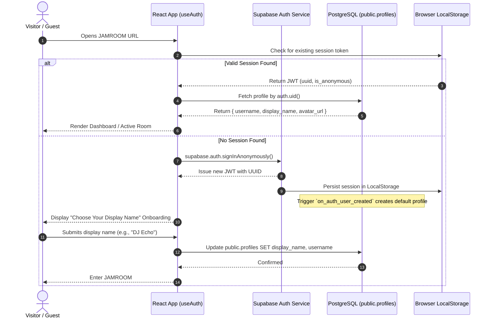

# JAMROOM — Guest Identity & Authentication Architecture (Audited & Hardened)

## 1. Zero-Friction Guest Experience Philosophy

Traditional music streaming and social platforms impose sign-up walls (email, password verification, social OAuth) that result in high drop-off rates for casual listeners. **JAMROOM mandates a Guest-Only architecture**:
- **Zero Registration**: No email/password forms, no verification emails, and no third-party OAuth barriers.
- **Immediate Utility**: A visitor lands on the site, receives a secure guest identity automatically, picks a display name, and can immediately start listening, chatting, or hosting.
- **Cryptographic Security**: Guest sessions are not insecure client-generated cookies or unauthenticated usernames; they are powered by **Supabase Anonymous Authentication**, yielding an immutable UUID, an authenticated JWT, and full Row-Level Security (RLS) enforcement.
- **Session Durability**: Guest identities and room ownership survive page refreshes, tab closures, browser restarts, and temporary network disconnections.

---

## 2. Supabase Anonymous Authentication Lifecycle



### 2.1 Technical Mechanism
1. **Anonymous Sign-In**:
   ```typescript
   // features/auth/services/authService.ts
   import { supabase } from '@/services/supabaseClient';

   export async function initializeGuestSession() {
     const { data: { session } } = await supabase.auth.getSession();
     if (session?.user) {
       return session.user;
     }

     const { data, error } = await supabase.auth.signInAnonymously();
     if (error) throw error;
     return data.user;
   }
   ```
2. **Session Storage & Auto-Refresh**:
   - The Supabase client persists the session in `window.localStorage` under the key `sb-<project-ref>-auth-token`.
   - The SDK handles silent token refresh before the JWT expiration (`exp`).
   - Normal page navigation, browser refreshes (`F5`), and reopening closed tabs restore the exact same `auth.users.id`.

### 2.2 Safari ITP & In-App Webview Storage Considerations
Apple Safari's Intelligent Tracking Prevention (ITP) and mobile in-app webviews (Instagram, Reddit, Discord) may clear `localStorage` after 7 days of inactivity.
- **Client Mitigation**: JAMROOM exposes a "Backup Identity Token" in user profile settings. Guests can export a compact recovery string or save their Room Emergency Recovery Key to instantly restore their administrative identity on any browser or device.

---

## 3. Profile Onboarding & Display Name Management

### 3.1 Display Name Selection
When a new guest session is initialized, a default profile is created via a PostgreSQL trigger (`guest_a1b2c3d4`). To make the experience social and personal, the user is presented with a non-intrusive onboarding dialog:
- **Input Field**: 2 to 30 characters, supporting UTF-8 emoji and international characters.
- **Randomizer Button ("Surprise Me")**: Generates catchy music-themed pseudonyms (e.g., *FunkyBass*, *VinylVibes*, *NeonDrop*, *LoFiBeats*).
- **Avatar Selector**: Offers instant avatars generated via DiceBear API based on user UUID or randomized seeds.

### 3.2 Room-Level Display Name Conflict Resolution
- When joining a room via `join_room`, the system checks currently active members in `room_members` and Presence.
- If a name collision occurs (e.g., another active "Alex" exists in the room), the UI appends a subtle identifier tag (e.g., "Alex #2" or "Alex (DJ)"), preserving user preference while eliminating room confusion.

---

## 4. Hardened Room Ownership Recovery & Token Rotation

A critical vulnerability in anonymous platforms is the accidental loss or malicious hijacking of room administrative ownership. JAMROOM implements an enterprise-grade recovery procedure backed by the zero-access `room_secrets` table.

### 4.1 Anti-Brute-Force & Recovery Lifecycle
1. **Creation**: When a room is created, an Emergency Recovery Token (e.g., `jam-7x9q-k2lm-8910-w4z1`, 128-bit entropy) is generated on the server, returned to the creator once, and hashed using `crypt(token, gen_salt('bf'))` inside `room_secrets.recovery_hash`.
2. **Brute-Force Protection**: The server tracks `failed_recovery_attempts`. If 5 consecutive invalid tokens are entered, `recovery_locked_until` is set to `clock_timestamp() + INTERVAL '1 hour'`, immediately blocking subsequent attempts.
3. **One-Time Token Rotation**: Upon successful recovery, the old token is permanently invalidated, a brand-new token is generated and returned to the caller, and the previous owner is demoted in `room_members` to prevent dual-owner conflicts.

### 4.2 Production Stored Procedure: `rpc_claim_room_ownership`
```sql
CREATE OR REPLACE FUNCTION public.rpc_claim_room_ownership(
    p_room_id UUID,
    p_recovery_token TEXT
)
RETURNS JSONB AS $$
DECLARE
    v_user_id UUID := auth.uid();
    v_secret public.room_secrets%ROWTYPE;
    v_room public.rooms%ROWTYPE;
    v_old_owner_id UUID;
    v_new_token TEXT;
    v_new_hash TEXT;
BEGIN
    IF v_user_id IS NULL THEN
        RAISE EXCEPTION 'Authentication required';
    END IF;

    -- 1. Check room existence
    SELECT * INTO v_room FROM public.rooms WHERE id = p_room_id;
    IF NOT FOUND THEN
        RAISE EXCEPTION 'Room not found';
    END IF;

    v_old_owner_id := v_room.owner_id;

    -- 2. Fetch secrets with exclusive lock
    SELECT * INTO v_secret FROM public.room_secrets WHERE room_id = p_room_id FOR UPDATE;
    IF NOT FOUND THEN
        RAISE EXCEPTION 'Room security configuration missing';
    END IF;

    -- 3. Check lockout status
    IF v_secret.recovery_locked_until IS NOT NULL AND v_secret.recovery_locked_until > clock_timestamp() THEN
        RAISE EXCEPTION 'Recovery temporarily locked due to excessive failed attempts. Please try again later.';
    END IF;

    -- 4. Verify recovery token
    IF v_secret.recovery_hash IS NULL OR v_secret.recovery_hash != crypt(p_recovery_token, v_secret.recovery_hash) THEN
        UPDATE public.room_secrets
        SET failed_recovery_attempts = failed_recovery_attempts + 1,
            recovery_locked_until = CASE WHEN failed_recovery_attempts + 1 >= 5 THEN clock_timestamp() + INTERVAL '1 hour' ELSE NULL END,
            updated_at = clock_timestamp()
        WHERE room_id = p_room_id;

        RAISE EXCEPTION 'Invalid recovery token';
    END IF;

    -- 5. Generate new 128-bit rotated recovery token
    v_new_token := 'jam-' || encode(gen_random_bytes(12), 'hex');
    v_new_hash := crypt(v_new_token, gen_salt('bf'));

    -- 6. Rotate secret and reset attempts
    UPDATE public.room_secrets
    SET recovery_hash = v_new_hash,
        failed_recovery_attempts = 0,
        recovery_locked_until = NULL,
        updated_at = clock_timestamp()
    WHERE room_id = p_room_id;

    -- 7. Update room ownership
    UPDATE public.rooms
    SET owner_id = v_user_id, updated_at = clock_timestamp()
    WHERE id = p_room_id;

    -- 8. Demote old owner if still a member; promote caller to owner
    UPDATE public.room_members
    SET role = 'moderator', updated_at = clock_timestamp()
    WHERE room_id = p_room_id AND user_id = v_old_owner_id;

    INSERT INTO public.room_members (room_id, user_id, role, has_valid_passcode, joined_at, last_active_at)
    VALUES (p_room_id, v_user_id, 'owner', true, clock_timestamp(), clock_timestamp())
    ON CONFLICT (room_id, user_id) DO UPDATE SET role = 'owner', has_valid_passcode = true, last_active_at = clock_timestamp();

    RETURN jsonb_build_object(
        'success', true,
        'message', 'Ownership successfully claimed',
        'new_recovery_token', v_new_token
    );
END;
$$ LANGUAGE plpgsql SECURITY DEFINER;
```

---

## 5. Inactivity, Expiration & Pruning Policies

Anonymous users who abandon the platform can clutter the database over time. However, **a guest identity that owns an active room must NEVER be deleted**.

### 5.1 Pruning Policy Specification
1. A guest profile is deemed **stale** if `last_seen_at < NOW() - INTERVAL '30 days'`.
2. A stale guest profile is **prunable** ONLY IF:
   - The user does **not** own any room with `status = 'active'`.
   - The user has **not** saved public playlists.
3. If an active room has had no online presence for 14 days, the room status is transitioned to `'archived'`. Once archived, its associated abandoned anonymous profiles become eligible for deletion during the next pruning cycle.

### 5.2 Scheduled Pruning Job (PostgreSQL Function)
```sql
CREATE OR REPLACE FUNCTION public.prune_abandoned_guest_accounts()
RETURNS TABLE(deleted_count INTEGER) AS $$
DECLARE
    v_count INTEGER;
BEGIN
    WITH candidates AS (
        SELECT p.id
        FROM public.profiles p
        JOIN auth.users u ON u.id = p.id
        WHERE (u.is_anonymous IS TRUE OR u.email IS NULL)
          AND p.last_seen_at < (clock_timestamp() - INTERVAL '30 days')
          AND NOT EXISTS (
              SELECT 1 FROM public.rooms r
              WHERE r.owner_id = p.id AND r.status = 'active'
          )
        LIMIT 500
    )
    DELETE FROM auth.users
    WHERE id IN (SELECT id FROM candidates);

    GET DIAGNOSTICS v_count = ROW_COUNT;
    RETURN QUERY SELECT v_count;
END;
$$ LANGUAGE plpgsql SECURITY DEFINER;
```
