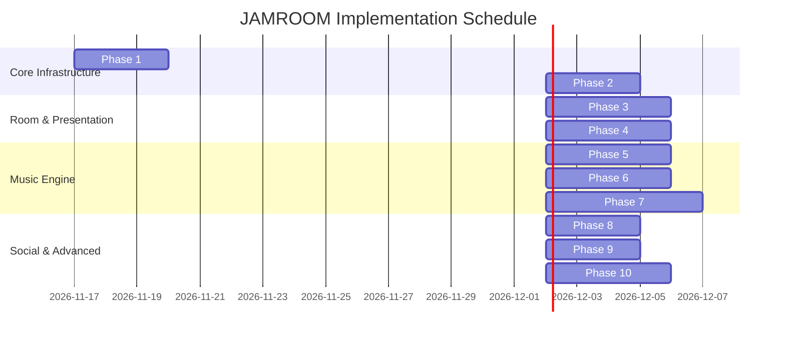
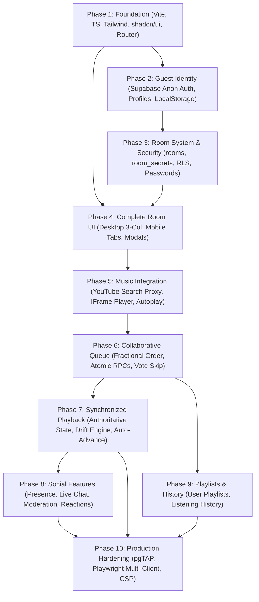

# JAMROOM — Implementation Roadmap & Execution Plan (Audited & Hardened)

## 1. Overview & Phasing Strategy

The JAMROOM development execution is organized into **10 distinct, sequential, and testable phases**. Each phase produces demonstrable, verifiable value before subsequent phases build upon it.

---

## 2. Implementation Dependency Graph

---

## 3. Phase-by-Phase Execution Breakdown

### PHASE 1 — Foundation & Design System
**Objective**: Scaffold a modern, type-safe, performant React application with a complete design foundation.
- **Granular Tasks**:
  1. `1.1`: Initialize Vite project with React 18/19, TypeScript (`strict: true`), ESLint, and Prettier.
  2. `1.2`: Configure Tailwind CSS with dark-mode first design tokens, CSS variables, and Lucide React icons.
  3. `1.3`: Scaffold `src/components/ui/` with core `shadcn/ui` primitives (Button, Dialog, Input, Slider, Sheet, Tooltip, DropdownMenu).
  4. `1.4`: Configure client routing via `react-router-dom` (`/`, `/explore`, `/rooms/:slugOrId`).
  5. `1.5`: Setup TanStack Query (`QueryClientProvider`) with hydration defaults (`staleTime: 10_000`).
  6. `1.6`: Implement generic responsive application shell with global navigation header and dark theme container.
- **Deliverables & Acceptance Criteria**:
  - `npm run build` compiles cleanly with zero TypeScript errors.
  - Dark-mode shell renders responsively across desktop, tablet, and mobile breakpoints.
  - Page navigation switches smoothly between route views.

---

### PHASE 2 — Guest Identity & Anonymous Authentication
**Objective**: Build zero-friction guest authentication, session persistence, and profile onboarding.
- **Granular Tasks**:
  1. `2.1`: Configure Supabase JS SDK client (`src/services/supabaseClient.ts`).
  2. `2.2`: Implement `authService.ts` executing `supabase.auth.signInAnonymously()`.
  3. `2.3`: Deploy PostgreSQL migration for `public.profiles` and `on_auth_user_created` trigger.
  4. `2.4`: Build `useAuthStore` (Zustand) tracking user identity, JWT state, and profile metadata.
  5. `2.5`: Implement Display Name Onboarding Dialog with instant randomized suggestions and DiceBear avatar selector.
  6. `2.6`: Implement Session Export / Identity String backup tool in user settings (protecting against Safari ITP).
  7. `2.7`: Implement automated pruning stored procedure `prune_abandoned_guest_accounts`.
- **Deliverables & Acceptance Criteria**:
  - First-time visitor automatically receives a persistent UUID identity.
  - Profile customization persists in `public.profiles`.
  - Browser refresh (`F5`) and tab reopening retain the exact same guest session.

---

### PHASE 3 — Room System & Permissions
**Objective**: Implement virtual room creation, slug generation, discovery, and privacy controls.
- **Granular Tasks**:
  1. `3.1`: Deploy database tables `rooms`, `room_secrets`, and `room_members` with hardened non-recursive RLS.
  2. `3.2`: Implement room creation modal with custom slug validation and privacy options (`public`, `unlisted`, `password`).
  3. `3.3`: Implement `rpc_join_room` validating passcodes and enrolling member into `room_members`.
  4. `3.4`: Implement Emergency Recovery Key generation and `rpc_claim_room_ownership` with brute-force lockout and key rotation.
  5. `3.5`: Build Public Lobby / Explorer page (`/explore`) with search and room card previews.
  6. `3.6`: Deploy `rpc_assert_room_permission` to enforce host, moderator, and shared speaker roles.
- **Deliverables & Acceptance Criteria**:
  - Users can create and join public, unlisted, and password-protected rooms.
  - Room passwords and recovery tokens are quarantined in `room_secrets` with zero client RLS leakage.
  - Room creator maintains ownership across refreshes and can recover ownership on new devices via recovery key.

---

### PHASE 4 — Complete Room UI & Responsive Shell
**Objective**: Build the full desktop studio layout and responsive mobile drawers.
- **Granular Tasks**:
  1. `4.1`: Build 3-column desktop layout: Queue Sidebar (Left), Main Stage Player (Center), Social & Chat (Right).
  2. `4.2`: Build mobile responsive layout with sticky docked 16:9 player and bottom tab navigation (Now Playing, Queue, Chat, People).
  3. `4.3`: Build Now Playing stage with animated waveform, track metadata, and scrub bar.
  4. `4.4`: Build Queue item list with track duration, user attribution tag, and drag handles.
  5. `4.5`: Build Room Settings Dialog (shared speakers toggle, skip vote threshold slider, chat toggle).
  6. `4.6`: Build Member Roster with role badges (Owner, Mod, Member).
- **Deliverables & Acceptance Criteria**:
  - Fluid UI switching cleanly between desktop Pro layout and mobile tabbed drawers.
  - WCAG 2.1 AA compliant color contrast and keyboard navigation.

---

### PHASE 5 — Music Integration & YouTube Player
**Objective**: Connect YouTube Data API v3 search and embed the YouTube IFrame Player.
- **Granular Tasks**:
  1. `5.1`: Deploy Supabase Edge Function `/api/search-youtube` with query normalization and 48-hour cache in `youtube_search_cache`.
  2. `5.2`: Implement Direct YouTube URL / Video ID paste parser (bypassing search quota).
  3. `5.3`: Implement Music Search Dialog with debounced search, thumbnails, and channel info.
  4. `5.4`: Create encapsulated React wrapper for YouTube IFrame Player API complying with minimum 200x200px visibility rules.
  5. `5.5`: Implement "Enable Audio / Join Listening" floating banner to unlock browser autoplay policies.
  6. `5.6`: Wire player controls (Play, Pause, Mute, Volume, Fullscreen) and handle YouTube error codes (`100`, `101`, `150`).
- **Deliverables & Acceptance Criteria**:
  - Cached YouTube search returns results in <300ms without client key exposure.
  - Direct URL paste allows instant queuing even when search quota is depleted.
  - Clicking "Join Listening" successfully starts unmuted audio playback on user's device.

---

### PHASE 6 — Collaborative Queue & Concurrency Strategy
**Objective**: Deliver a multi-user collaborative queue with atomic operations and skip voting.
- **Granular Tasks**:
  1. `6.1`: Deploy `queue_items` table with `NUMERIC(20, 10)` fractional indexing.
  2. `6.2`: Deploy atomic stored procedures: `rpc_add_queue_item`, `rpc_remove_queue_item`, `rpc_reorder_queue`.
  3. `6.3`: Implement automatic position re-normalization when adjacent gaps fall below `0.0001`.
  4. `6.4`: Integrate drag-and-drop queue reordering (`@hello-pangea/dnd`).
  5. `6.5`: Deploy `skip_votes` table and `rpc_vote_to_skip` (with server-authoritative active member calculation).
  6. `6.6`: Build real-time Skip Vote progress bar and toast notifications.
- **Deliverables & Acceptance Criteria**:
  - Multiple users can add, remove, and reorder tracks concurrently with zero duplicate positions or ordering corruption.
  - Skip votes accurately calculate thresholds based on server-evaluated active heartbeats.

---

### PHASE 7 — Synchronized Playback Engine
**Objective**: Implement the authoritative playback state machine and multi-device synchronization.
- **Granular Tasks**:
  1. `7.1`: Deploy `playback_states` table with monotonic `playback_version` and server timestamps.
  2. `7.2`: Deploy `rpc_set_playback_state` with optimistic concurrency locking.
  3. `7.3`: Deploy `rpc_advance_to_next_song` to coordinate song transitions atomically.
  4. `7.4`: Build `usePlaybackSync` hook with calibrated 3-tier drift detection:
     - $|\text{drift}| \le 0.75\text{s}$: In-sync.
     - $|\text{drift}| > 0.75\text{s}$: Throttled `seekTo` with 3.0s cooldown.
     - Within 2.0s of track end: Suppress seeking.
  5. `7.5`: Implement late-joiner catchup (instant snap to elapsed position).
  6. `7.6`: Implement background tab wake reconciliation (`visibilitychange`).
- **Deliverables & Acceptance Criteria**:
  - Multiple browser instances maintain synchronized audio playback within sub-second tolerance.
  - Late-joining clients immediately snap to the exact playback timestamp.
  - When a song ends, the queue advances to the next track exactly once across all devices.

---

### PHASE 8 — Social Features, Chat & Presence
**Objective**: Deliver real-time room presence, interactive chat, and host moderation tools.
- **Granular Tasks**:
  1. `8.1`: Implement Supabase Presence channel (`room:${roomId}:presence`) tracking member rosters and audio status.
  2. `8.2`: Implement 30-second heartbeat ping calling `rpc_touch_member_activity`.
  3. `8.3`: Build Live Chat UI with real-time CDC updates on `messages` table.
  4. `8.4`: Implement Broadcast channel for ephemeral floating emoji reactions (`🔥`, `❤️`, `🎉`, `⚡`).
  5. `8.5`: Implement Moderation controls: kick member, mute in chat, delete messages.
  6. `8.6`: Implement Owner role controls: promote/demote moderators, transfer room ownership.
- **Deliverables & Acceptance Criteria**:
  - Live member roster updates within 1 second of joins/leaves.
  - Chat stream delivers messages with zero perceived latency.
  - Floating emoji reactions synchronize across all viewer viewports.

---

### PHASE 9 — Playlists & Playback History
**Objective**: Allow guests to build personal playlists and browse past room sessions.
- **Granular Tasks**:
  1. `9.1`: Deploy `playlists`, `playlist_items`, and `playback_history` tables.
  2. `9.2`: Build personal playlist management UI in user profile drawer.
  3. `9.3`: Implement "Import Playlist to Room Queue" bulk-addition action.
  4. `9.4`: Build Room Playback History drawer with one-click re-queue buttons.
- **Deliverables & Acceptance Criteria**:
  - Playlists persist reliably with guest session identities.
  - Completed songs automatically log to `playback_history`.

---

### PHASE 10 — Production Hardening & Testing
**Objective**: Execute comprehensive security audits, load testing, performance tuning, and documentation.
- **Granular Tasks**:
  1. `10.1`: Run pgTAP unit test suite verifying RLS policies, zero-access on `room_secrets`, and RPC security.
  2. `10.2`: Execute Playwright automated multi-browser test: launch 3 simultaneous browser contexts in a single room and assert playback sync drift remains $< 0.75\text{s}$.
  3. `10.3`: Concurrency torture test: execute 50 parallel requests to `advance_to_next_song` to verify exactly-once transition.
  4. `10.4`: Cross-browser audit (Chrome, Safari, Firefox, Edge, iOS Safari, Android Chrome).
  5. `10.5`: Configure Content-Security-Policy (CSP) headers and production environment safeguards.
  6. `10.6`: Finalize deployment runbook (Vercel/Netlify frontend + Supabase backend).
- **Deliverables & Acceptance Criteria**:
  - All automated tests pass with 100% assertions.
  - Lighthouse performance score $\ge 90$.
  - Zero critical security vulnerabilities or RLS bypasses.
