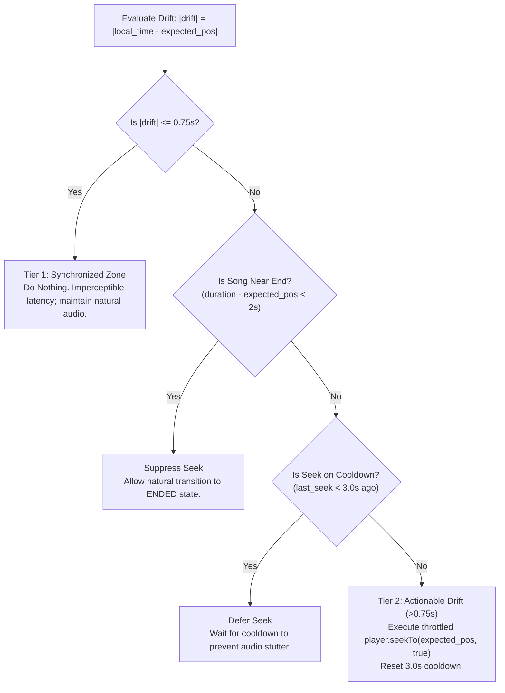

# JAMROOM — Authoritative Playback Synchronization Engine (Audited & Hardened)

## 1. Core Principle: Decentralized Audio, Authoritative Truth

In JAMROOM, every connected client in a room runs an independent local instance of the **YouTube IFrame Player API**. However, no client decides its own playback timeline. Audio playback across all participants is strictly synchronized through an **Authoritative Backend State Engine** hosted in PostgreSQL (`playback_states`).

```
                ┌──────────────────────────────────────────────┐
                │        PostgreSQL: playback_states           │
                │  position_seconds: 45.2                      │
                │  is_playing: true                            │
                │  server_updated_at: 2026-11-16T07:50:00.000Z │
                │  playback_version: 12                        │
                └──────────────────────┬───────────────────────┘
                                       │ Supabase Realtime CDC
            ┌──────────────────────────┼──────────────────────────┐
            ▼                          ▼                          ▼
     ┌─────────────┐            ┌─────────────┐            ┌─────────────┐
     │   User A    │            │   User B    │            │ User C (New)│
     │ YT Player   │            │ YT Player   │            │ YT Player   │
     │ Local: 47.1s│            │ Local: 46.9s│            │ Joined: 47.2│
     └─────────────┘            └─────────────┘            └─────────────┘
```

---

## 2. Authoritative Mathematical Model

### 2.1 State Definition (`playback_states`)
```sql
CREATE TABLE public.playback_states (
    room_id UUID PRIMARY KEY REFERENCES public.rooms(id) ON DELETE CASCADE,
    current_queue_item_id UUID REFERENCES public.queue_items(id) ON DELETE SET NULL,
    current_song_id UUID REFERENCES public.songs(id) ON DELETE SET NULL,
    is_playing BOOLEAN NOT NULL DEFAULT false,
    position_seconds NUMERIC(10, 3) NOT NULL DEFAULT 0.000,
    server_updated_at TIMESTAMPTZ NOT NULL DEFAULT clock_timestamp(),
    playback_version BIGINT NOT NULL DEFAULT 1,
    updated_by UUID REFERENCES public.profiles(id) ON DELETE SET NULL,
    updated_at TIMESTAMPTZ NOT NULL DEFAULT clock_timestamp()
);
```

### 2.2 Expected Position Calculation Formula
When a client evaluates what playback time should currently be rendered:

$$\Delta t_{server} = \text{current\_server\_time} - \text{server\_updated\_at}$$

1. **If the song is currently PLAYING (`is_playing = true`)**:
   $$\text{expected\_position} = \text{position\_seconds} + \Delta t_{server}$$
   *If $\text{expected\_position} \ge \text{duration\_seconds}$, the song has completed.*

2. **If the song is PAUSED (`is_playing = false`)**:
   $$\text{expected\_position} = \text{position\_seconds}$$

### 2.3 Clock Skew Correction
Because client device clocks may deviate from server time:
- The client measures $\text{clock\_offset} = \text{ClientTime} - \text{ServerTime}$ during initial handshake and HTTP RPC calls.
- $\text{current\_server\_time} = \text{Date.now}() - \text{clock\_offset}$.

---

## 3. Playback Versioning & Stale Event Rejection

In distributed real-time systems, network jitter can cause WebSocket events to arrive out of order (e.g., a "Pause at 10s" event arriving after a "Play at 12s" event).

JAMROOM uses a monotonic integer counter: `playback_version BIGINT`.
- Every valid playback mutation (`set_playback_state`, `advance_to_next_song`, `skip`) increments `playback_version = playback_version + 1`.
- When a client receives a state update:
  ```typescript
  if (incomingUpdate.playback_version <= localState.playback_version) {
    console.warn(`[SyncEngine] Dropping stale update v${incomingUpdate.playback_version} (current v${localState.playback_version})`);
    return;
  }
  localState.playback_version = incomingUpdate.playback_version;
  ```

---

## 4. YouTube IFrame API Capabilities & Drift Correction Strategy

### 4.1 Verified YouTube IFrame API Constraints
A critical finding during architecture review:
- The YouTube IFrame Player API (`player.getAvailablePlaybackRates()`) **only supports discrete values**: `[0.25, 0.5, 0.75, 1, 1.25, 1.5, 2]`.
- Arbitrary micro-rates (such as `1.05x` or `0.95x`) are **not supported** by the official YouTube player API and are ignored.
- Therefore, synchronization drift must be managed via **calibrated, throttled seeks (`player.seekTo`)** combined with natural audio buffering tolerance.

### 4.2 Calibrated Drift Strategy

$$\text{drift} = \text{local\_player\_position} - \text{expected\_position}$$



### Drift Tuning Matrix
| Drift Range | Classification | Action Taken | Rationale & User Impact |
| :--- | :--- | :--- | :--- |
| **$|\text{drift}| \le 0.75\text{s}$** | **Tier 1: Synchronized** | No action. Local clock natural variance. | Completely imperceptible across separate physical rooms or headphones. |
| **$|\text{drift}| > 0.75\text{s}$** | **Tier 2: Actionable Drift** | Execute `player.seekTo(expected_pos, true)` subject to **3.0s cooldown**. | Smooth convergence without rapid seek-stuttering. |
| **Song Boundary** | **Boundary Zone** | If within 2.0s of track end, suppress seeking. | Prevents buffer thrashing right before track advancement. |

Drift checks execute every **2.5 seconds**, immediately upon window focus / tab refocus (`visibilitychange`), and upon receiving Realtime CDC state broadcasts.

---

## 5. YouTube API Terms of Service & Player Sizing Requirements

To prevent domain blocking and comply strictly with YouTube API Developer Policies:
1. **Minimum Dimensions**: The player element must be at least **200px by 200px** (JAMROOM enforces a standard 16:9 ratio, min 320x180px on mobile).
2. **Never Hidden**: The player must **never** be styled with `display: none`, `visibility: hidden`, `opacity: 0`, or hidden behind overlapping UI.
3. **Mobile Docked Mini-Player**: On mobile devices, when users switch between "Queue" and "Chat" tabs, the video player remains docked as a persistent 16:9 floating or top-docked viewport so playback and YouTube branding remain fully compliant.

---

## 6. Browser Autoplay Restrictions & The "Join Listening" UX

Modern web browsers (Chrome, Safari, Firefox, Edge) block unmuted programmatic media playback until the user has performed a direct interaction (click or tap) in the document.

### The Autoplay Challenge
If a user clicks an invite link to a room where a song is already halfway playing:
- Calling `player.playVideo()` immediately will be blocked by the browser with `NotAllowedError: play() failed because the user didn't interact with the document first`.

### The Solution: "Enable Audio / Join Listening" Experience
1. **Initial Cued State**: When joining an active room, the YouTube player loads the video in a paused/cued state at the calculated `expected_position`.
2. **Prominent Floating UI Banner**: A sleek, animated glassmorphism banner appears:
   > 🎧 **Music is playing in this room!**
   > [ **Join Listening / Enable Audio** ]
3. **User Activation**: When the user clicks the button:
   - The click handler directly calls `player.playVideo()`.
   - The browser Web Audio / media context is unlocked.
   - The banner fades out; the local store sets `isAudioUnlocked = true`.
   - The user seamlessly blends into the synchronized live stream.
4. **Persistent Permission**: Once clicked, subsequent song transitions and play/pause events play automatically without further user intervention.

---

## 7. Atomic End-of-Song Transition Coordination

Song transitions are coordinated through the atomic PostgreSQL function `rpc_advance_to_next_song`:

```sql
CREATE OR REPLACE FUNCTION public.rpc_advance_to_next_song(
    p_room_id UUID,
    p_expected_queue_item_id UUID,
    p_expected_version BIGINT
)
RETURNS JSONB AS $$
DECLARE
    v_state public.playback_states%ROWTYPE;
    v_next_item public.queue_items%ROWTYPE;
    v_new_version BIGINT;
BEGIN
    -- Acquire exclusive row lock on playback_states for this room
    SELECT * INTO v_state
    FROM public.playback_states
    WHERE room_id = p_room_id
    FOR UPDATE;

    IF NOT FOUND THEN
        RETURN jsonb_build_object('success', false, 'reason', 'ROOM_NOT_FOUND');
    END IF;

    -- Concurrency check: has another client or the server already advanced?
    IF v_state.current_queue_item_id IS DISTINCT FROM p_expected_queue_item_id
       OR v_state.playback_version != p_expected_version THEN
        -- Safely ignore duplicate advance requests
        RETURN jsonb_build_object('success', false, 'reason', 'ALREADY_ADVANCED');
    END IF;

    -- 1. Archive current song to playback_history
    IF v_state.current_song_id IS NOT NULL THEN
        INSERT INTO public.playback_history (room_id, song_id, played_at, duration_seconds)
        SELECT v_state.room_id, s.id, clock_timestamp(), s.duration_seconds
        FROM public.songs s WHERE s.id = v_state.current_song_id;
    END IF;

    -- 2. Mark current queue item as 'played'
    IF v_state.current_queue_item_id IS NOT NULL THEN
        UPDATE public.queue_items
        SET status = 'played', updated_at = clock_timestamp()
        WHERE id = v_state.current_queue_item_id;
    END IF;

    -- 3. Fetch next queued track ordered by position
    SELECT * INTO v_next_item
    FROM public.queue_items
    WHERE room_id = p_room_id AND status = 'queued'
    ORDER BY position ASC
    LIMIT 1;

    v_new_version := v_state.playback_version + 1;

    -- 4. Transition playback state
    IF FOUND THEN
        UPDATE public.queue_items SET status = 'playing', updated_at = clock_timestamp() WHERE id = v_next_item.id;

        UPDATE public.playback_states
        SET current_queue_item_id = v_next_item.id,
            current_song_id = v_next_item.song_id,
            is_playing = true,
            position_seconds = 0.000,
            server_updated_at = clock_timestamp(),
            playback_version = v_new_version,
            updated_at = clock_timestamp()
        WHERE room_id = p_room_id;
    ELSE
        -- Queue is empty: stop playback
        UPDATE public.playback_states
        SET current_queue_item_id = NULL,
            current_song_id = NULL,
            is_playing = false,
            position_seconds = 0.000,
            server_updated_at = clock_timestamp(),
            playback_version = v_new_version,
            updated_at = clock_timestamp()
        WHERE room_id = p_room_id;
    END IF;

    RETURN jsonb_build_object('success', true, 'new_version', v_new_version);
END;
$$ LANGUAGE plpgsql SECURITY DEFINER;
```

---

## 8. Edge Cases & Resilience

1. **Late Joiners**: Snap immediately to $\text{expected\_position}$ calculated via server timestamps.
2. **Client Buffering**: Local buffering does not pause other clients; when buffering resolves, client calculates updated $\text{expected\_position}$ and catches up.
3. **Restricted / Deleted Videos (Error 100/101/150)**: UI notifies the room and auto-advances to the next song cleanly.
4. **Device Sleep / Wake**: Re-synchronize automatically via `visibilitychange` listener.
