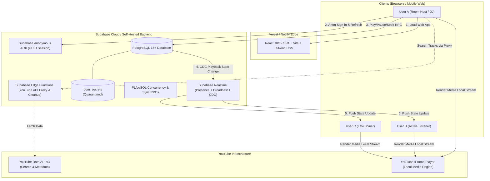

# JAMROOM — Project Overview (Audited & Hardened)

## 1. Executive Summary

**JAMROOM** is a modern, real-time, collaborative music listening and social synchronization platform. Designed for friends, remote teams, music enthusiasts, and online communities, JAMROOM enables multiple users across different devices to listen to music simultaneously in synchronized virtual rooms.

Unlike traditional audio streaming apps or single-device playback models (such as screen sharing or Discord bots), JAMROOM implements an **All-Devices Synchronized Playback Engine**: every connected participant has an independent YouTube IFrame Player instance rendered in their browser, but every instance is strictly governed by an **Authoritative Backend Playback State**. When a room host or authorized member plays, pauses, seeks, or skips, all connected devices across the world respond in unison.

JAMROOM eliminates onboarding friction entirely with a **Guest-Only Authentication Model**. Visitors do not need to fill out registration forms or verify emails. Using Supabase Anonymous Authentication, every visitor is assigned a persistent, cryptographically secure UUID identity and picks a display name in seconds, while room ownership and memberships securely survive page refreshes and network reconnects.

---

## 2. Product Pillars & Final Architectural Decisions

### Pillar 1: Zero-Friction Guest Identity (Guest-Only)
- **No Traditional Registration**: No email/password sign-up or mandatory OAuth walls.
- **Supabase Anonymous Authentication**: Every visitor automatically receives a valid Supabase Auth session with an immutable UUID.
- **Display Name Onboarding**: Users pick a display name on first visit; randomized, music-themed suggestions are provided.
- **Session Persistence**: Sessions survive page reloads, tab crashes, and navigation via browser storage token persistence.
- **Ownership Resilience & Quarantine**: Room credentials and emergency recovery keys are isolated in `room_secrets` with zero-client RLS access. Brute-force lockouts and automatic token rotation prevent account hijacking.
- **Backend Validation**: Every database operation and realtime channel event is validated against `auth.uid()`.

### Pillar 2: Authoritative All-Devices Playback Synchronization
- **Decentralized Audio, Centralized Truth**: Each user plays audio on their local device through YouTube's IFrame API, avoiding server audio re-encoding and copyright rebroadcast liabilities.
- **Authoritative Server State**: The backend PostgreSQL database (`playback_states`) holds the single source of truth (`position_seconds`, `is_playing`, `server_updated_at`, `playback_version`).
- **Verified Drift Management**: Calibrated to verified YouTube IFrame capabilities: imperceptible drift ($\le 0.75\text{s}$) is left untouched; drift $> 0.75\text{s}$ triggers throttled `seekTo` with a 3.0-second cooldown; seeks near song boundaries are suppressed.
- **Browser Autoplay Compliance**: An elegant "Enable Audio / Join Listening" user activation workflow ensures compliance with Web Audio and media autoplay policies without breaking sync.
- **Atomic Song Transitions**: Song completion is coordinated atomically via PostgreSQL stored procedures (`advance_to_next_song`) to prevent concurrent race-condition skips.
- **YouTube API Terms Compliance**: Enforces minimum 200x200px visible player dimensions and a persistent docked mobile mini-player during tab navigation.

### Pillar 3: Full-Featured Collaborative Experience
- **Public & Private Rooms**: Discover public rooms in the Lobby, share direct unlisted links, or protect private rooms with hashed passcodes.
- **Shared Speakers vs. Host Control**: Switch between an open collaborative "Shared Speakers" party mode and an organized "Host & Mods Only" DJ mode.
- **Collaborative Queue**: High-precision fractional indexing (`NUMERIC(20, 10)`) with automatic re-spacing, drag-and-drop reordering, and atomic position locking.
- **Democratic Skip Voting**: Server-authoritative skip threshold calculations based on active member heartbeats (`last_active_at`), preventing spoofed client denominators.
- **Real-Time Social Space**: Low-latency chat, animated emoji reactions, online presence rosters, and moderator toolkits.
- **Playlists & Playback History**: Save favorite tracklists and review past listening sessions.
- **Quota Conservation**: Cached YouTube search proxy combined with direct YouTube URL and Video ID pasting fallback.
- **Fully Responsive**: First-class experience across mobile smartphones, tablets, and wide desktop displays.

---

## 3. High-Level System Architecture

---

## 4. Product Modules & Scope Matrix

| Module | Scope / Key Capabilities | Primary Tech Stack |
| :--- | :--- | :--- |
| **Guest Identity** | Anon Auth, display name onboarding, session recovery, persistent UUID, inactive pruning | Supabase Auth, `profiles` table, Zustand |
| **Room System** | Public lobby, unlisted links, password protection, member roles (Owner, Mod, Member) | PostgreSQL, RLS, `rooms`, `room_secrets`, `room_members` |
| **Playback Sync** | Authoritative state, versioning, drift calculation, "Enable Audio" UI, auto-advance | `playback_states`, YouTube IFrame API, Realtime CDC |
| **Collaborative Queue** | Search YouTube & Direct URL, add to queue, fractional reorder, delete, skip voting | YouTube Data API, `queue_items`, PL/pgSQL RPCs |
| **Social & Chat** | Realtime text chat, emoji reactions, presence tracking, role badges, kick/mute | Supabase Presence & Broadcast, `messages` |
| **Playlists & History** | Create playlist, load playlist into queue, room history log | `playlists`, `playlist_items`, `playback_history` |
| **Room Settings** | Shared speakers toggle, skip vote threshold, chat toggle, max queue limits | `rooms.settings` JSONB, Settings Modal |

---

## 5. Architectural Non-Negotiables & Acceptance Criteria

1. **No Mandatory Registration**: No visitor is ever blocked by a login screen or email verification form.
2. **Persistent Ownership**: Room creators never lose ownership when refreshing the browser or briefly disconnecting.
3. **Multi-Device Synchronized Audio**: Audio plays locally on all devices matching the backend timestamp; no device is purely a "listener without audio" unless muted by choice.
4. **Resilient Drift Correction**: Clients smoothly align without constant audio skipping or seek stutters, respecting YouTube discrete rates.
5. **Autoplay Compliance**: Explicit user gesture ("Enable Audio / Join Listening") handles browser restrictions gracefully.
6. **Strict Concurrency**: Zero duplicate queue slots, zero multiple-skip race conditions, and zero lost updates.
7. **Robust Security & RLS**: All mutations are secured via PostgreSQL Row-Level Security and server-side RPC functions. Credentials are quarantined in `room_secrets`. Client roles and listener counts are never trusted.
